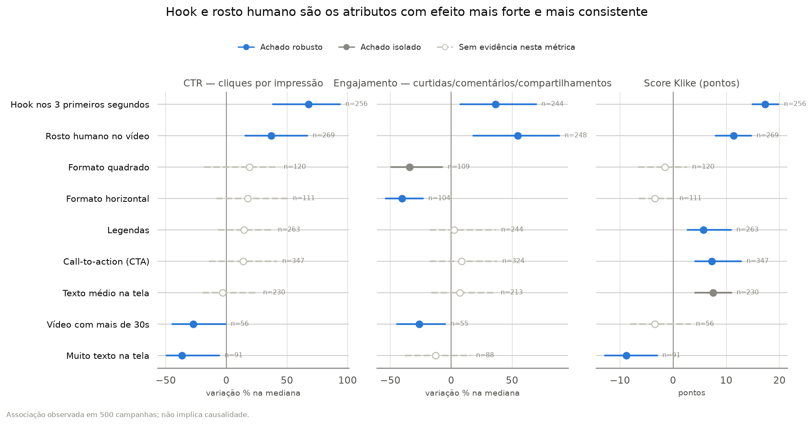
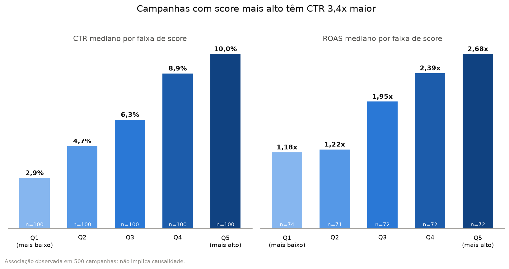
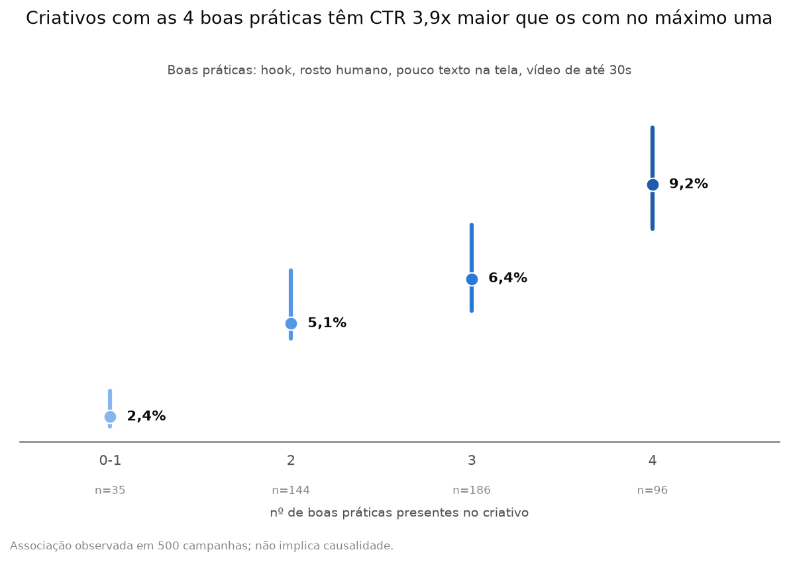
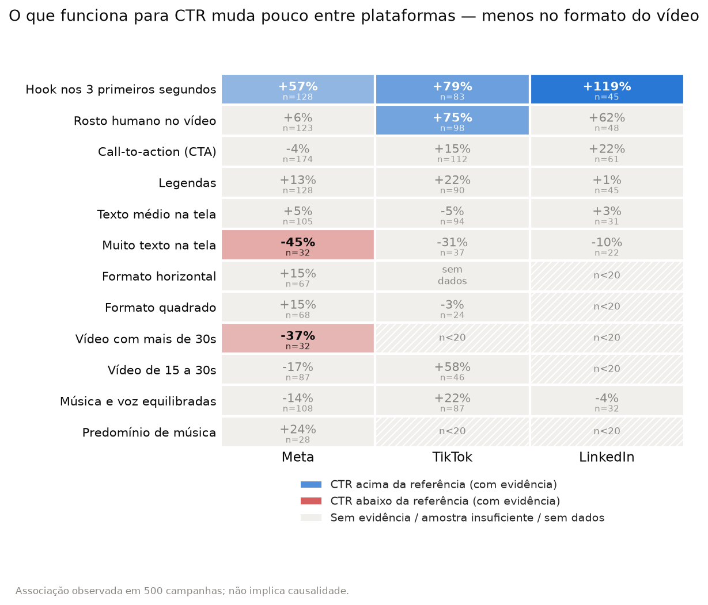
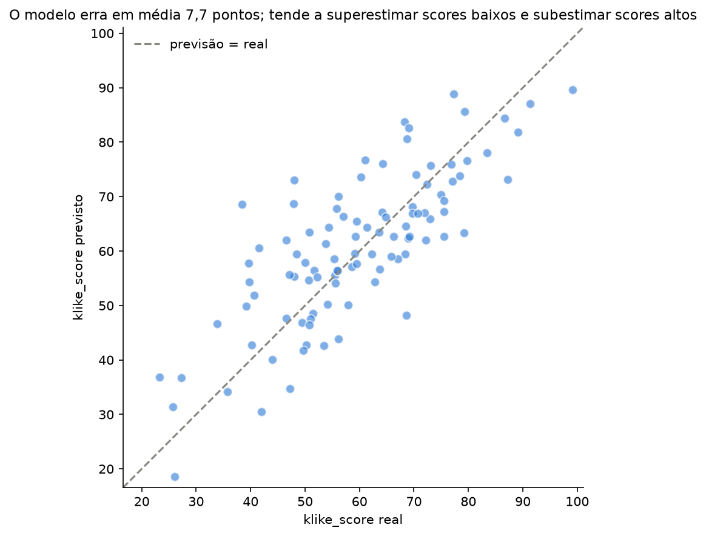
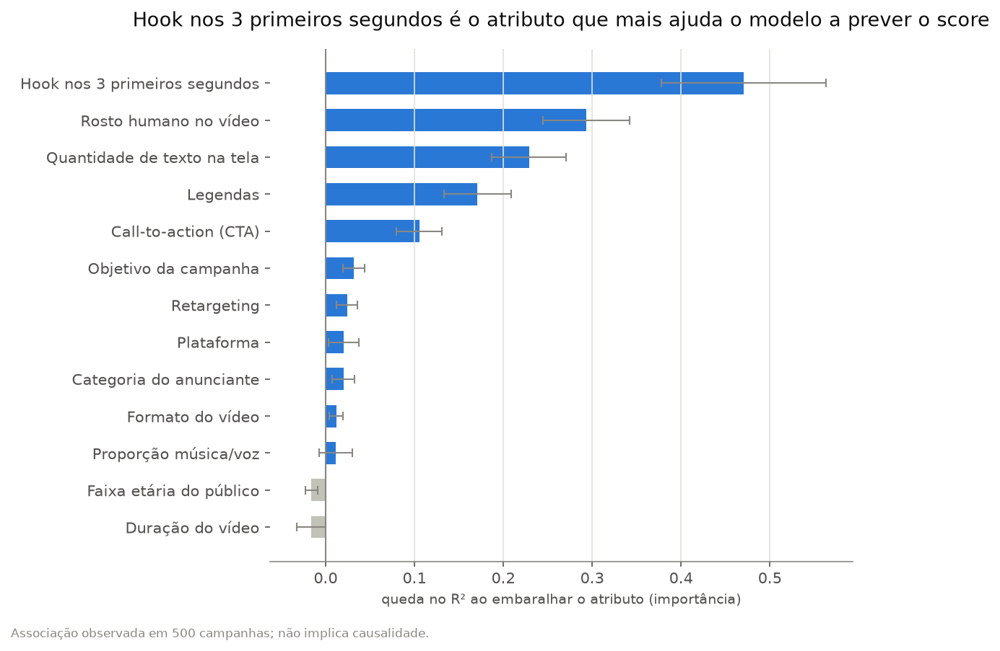

# Klike Data Science Challenge

## Visão geral

## Como rodar

Testado com **Python 3.14**.

```bash
python3 -m venv .venv
source .venv/bin/activate
pip install -r requirements.txt
jupyter notebook
```

Os notebooks estão em `notebooks/`, numerados na ordem em que devem ser executados:

- `01_eda.ipynb` — Parte 1
- `02_modeling.ipynb` — Parte 2
- `03_recommendations.ipynb` — Parte 3

Funções reutilizáveis ficam em `src/klike/`.

## Parte 1 — EDA

Análise completa, com código, em `notebooks/01_eda.ipynb`.

### 1. Perfil e qualidade dos dados

500 campanhas, 26 colunas. Como tratamos cada problema encontrado:

- **Valores faltantes** — 7 colunas com 5-9% de nulos cada, independentes entre si (não concentrados nas mesmas linhas). `cpc` e `revenue` foram **reconstruídos exatamente** a partir de outras colunas (cliques/gasto e ROAS/gasto). `has_subtitle`, `video_duration_s` e `music_voice_ratio` ficam para **imputação (moda/mediana) + indicador de nulo dentro do Pipeline** de modelagem — nunca antes do split, para não vazar dado. `avg_watch_time_s` e `engagement_rate` são só **excluídos no cálculo que usa aquela métrica específica** (análise de casos disponíveis).
- **Outliers** — mantidos: são extremos legítimos (ex.: campanhas de gasto muito alto), não erro de digitação. As análises usam mediana e, quando relevante, escala log; nenhum outlier legítimo foi removido.
- **Dados inconsistentes** — um bug converteu silenciosamente 46 nulos de `has_subtitle` em "tem legenda" (corrigido). Em 4 campanhas, `impressions` tinha valores fora de escala (1-2 ordens de grandeza acima das demais) e inconsistentes com cliques e CTR informados; em 3 campanhas, o gasto era inconsistente com cliques/receita. Em vez de descartar essas linhas, reconstruímos os valores mais prováveis usando as colunas que concordavam entre si (**triangulação**).
- **Branding** — receita zero em 100% das campanhas (61 de 61). Não é erro: esse tipo de campanha não é medido por conversão/receita. Excluímos `branding` das análises de ROAS.
- Detalhes completos, com os números de cada correção: [`docs/eda_qualidade.md`](docs/eda_qualidade.md).

### 2. Atributos x performance



Hook nos 3 primeiros segundos e rosto humano são os atributos com o efeito mais forte: ambos associados a CTR, engajamento e score mais altos. Hook se repete nas 3 plataformas; rosto tem a evidência mais forte no TikTok.



O score da Klike acompanha o resultado real: campanhas no quintil de score mais alto têm CTR ~3,4x maior e ROAS ~2,3x maior que as do quintil mais baixo.

**Score x performance real.** Dois atributos — **CTA** (repete nas 3 plataformas) e **legendas** (repete em Meta e TikTok) — elevam o `klike_score` de forma consistente, mas **não têm evidência de elevar nenhuma métrica real de performance** (CTR, engajamento, taxa de conversão ou ROAS). Isso importa: o score da Klike, sozinho, pode levar a recomendações que melhoram a nota do criativo sem melhorar o resultado da campanha. Por isso o Recommendations Engine (Parte 3) separa práticas com evidência em performance real das que só têm evidência em score.



Juntando as práticas com evidência em performance real (hook, rosto humano, pouco texto, vídeo curto) num único "placar": quanto mais boas práticas, maior o CTR mediano. **Ressalva:** essas 4 práticas foram escolhidas a partir desta mesma análise, o que favorece o resultado; a validação em dados não vistos é feita na Parte 2.

### 3. Diferenças entre plataformas



Hook é o único atributo associado a CTR maior nas 3 plataformas ao mesmo tempo. Rosto humano só tem evidência no TikTok; muito texto e vídeo longo, só no Meta. O formato do vídeo não pôde ser comparado no TikTok, que praticamente não usa formato horizontal (mix de plataforma, não falta de efeito).

### 4. Visualizações

As 4 visualizações da pergunta 4 estão acima, cada uma com a pergunta que responde: o que mais importa no criativo (forest plot), o score reflete performance real (score x CTR/ROAS), quantas boas práticas um criativo acumula (checklist) e o que muda por plataforma (heatmap). Um 5º gráfico (mix de formato/duração por plataforma) fica só no notebook técnico, como apoio à leitura do heatmap.

### Nota de método

Todo efeito usa a **mediana** (não a média — as métricas são bem assimétricas) e vem com uma **faixa de incerteza por bootstrap** (1000 reamostragens); só contamos um efeito como achado quando essa faixa não cruza o zero. Testamos 212 combinações de atributo x métrica x plataforma ao todo — ao acaso, ~11 delas dariam "achado" mesmo sem efeito real; encontramos 51, a maioria (44) confirmada em mais de uma métrica ou plataforma. Detalhes de cada achado, incluindo os que pareciam relevantes mas não se confirmaram: [`docs/eda_insights.md`](docs/eda_insights.md).

## Parte 2 — Modelagem

Análise completa, com código, em `notebooks/02_modeling.ipynb`.

### 1. Features e por quê

Cenário principal: **pré-veiculação** — só atributos conhecidos ANTES de rodar a campanha (sem nenhuma métrica de performance), porque é o único uso real do modelo (prever/recomendar antes de gastar dinheiro). 13 atributos viram 27 colunas no pré-processamento: one-hot de plataforma/categoria/objetivo/faixa etária/formato; densidade de texto como ordinal (pouco/médio/muito); duração do vídeo em escala log (é assimétrica — EDA, seção 1.7); `has_subtitle`, duração e proporção música/voz com imputação + indicador de nulo, sempre aprendida só no treino (nunca antes do split/CV). Criamos `n_boas_praticas` (hook + rosto + pouco texto + vídeo curto) **dentro do Pipeline**, depois de imputar a duração — senão um vídeo sem duração informada contaria errado como "não segue a prática".

**Ablação de `n_boas_praticas`:** rodamos a mesma validação cruzada do modelo escolhido com e sem essa feature (RMSE 9,13 vs. 9,14; R² 0,649 vs. 0,648) — a diferença é desprezível. Sendo honestos: para o modelo de árvores, que já capta essas interações sozinho, o resumo não melhora a previsão. Mantemos `n_boas_praticas` mesmo assim porque é útil como resumo interpretável no Recommendations Engine (Parte 3).

### 2. Modelo escolhido e por quê

Comparamos 4 modelos por validação cruzada (`RepeatedKFold`, 5 folds x 3 repetições) no treino:

| Modelo | RMSE | MAE | R² |
| :-- | :-- | :-- | :-- |
| Dummy (mediana) | 15,74 ± 1,20 | 12,75 ± 0,91 | -0,03 ± 0,03 |
| Ridge | 9,61 ± 0,54 | 7,77 ± 0,39 | 0,61 ± 0,06 |
| Random Forest | 9,69 ± 0,44 | 7,75 ± 0,34 | 0,61 ± 0,07 |
| **Gradient Boosting** | **9,13 ± 0,36** | **7,20 ± 0,34** | **0,65 ± 0,06** |

O Gradient Boosting venceu com folga: a diferença para o Ridge (0,48) é maior que 1 desvio padrão do melhor modelo (0,36), então não se aplica a regra de preferir o Ridge por interpretabilidade. Trocamos "coeficiente em pontos" por permutation importance (seção 4).

### 3. Avaliação e interpretação

No conjunto de teste (usado uma única vez): o modelo erra em média **7,7 pontos** (MAE) numa escala de 0 a 100 — **37% menos** que o baseline (12,3 pontos) — e explica **59%** da variância do score (R²). Não erra sistematicamente mais em nenhuma plataforma (MAE entre 6,1 e 9,1 pontos; amostra pequena por grupo no teste).



### 4. Feature importance e sentido de negócio



Bate com a Parte 1: hook e rosto humano são os 2 atributos mais importantes para o modelo — exatamente os que tinham o efeito mais forte em CTR/engajamento na EDA. CTA e legendas aparecem em seguida (4º e 5º lugar): o modelo confirma que CTA e legendas elevam o score; a ausência de efeito em performance real vem da Parte 1.

Duração do vídeo tem importância praticamente nula para o score, embora vídeos com mais de 30s estejam associados a CTR e engajamento menores (Parte 1). Ou seja, score e performance divergem nos dois sentidos: CTA e legendas sobem o score sem efeito comprovado em performance; duração afeta a performance sem afetar o score.

**Cenário comparativo "com performance":** incluir as métricas reais de performance eleva o R² de validação cruzada de 65% para 80% — esperado, já que o score correlaciona com CTR/ROAS (Parte 1). Esse cenário não é otimizado nem usado no Recommendations Engine, por não refletir o uso real (prever antes de rodar a campanha).

Modelo final salvo em `models/klike_model.joblib` via `train_and_save()` (`models/` está no `.gitignore` — rode a função para recriar o arquivo; a Parte 3 carrega esse Pipeline com `joblib.load`).

## Parte 3 — Recommendations Engine

## Parte 4 — Visão de produto

## Limitações
