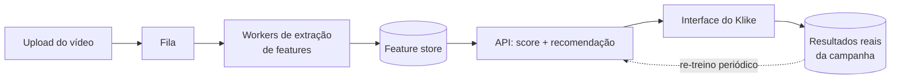

# Klike Data Science Challenge

## Visão geral

Pipeline completo de ciência de dados para o `klike_score` da Klike: diagnóstico e correção da qualidade dos dados, modelo preditivo pré-veiculação e um Recommendations Engine com recomendações acionáveis e quantificadas.

- **Qualidade dos dados** corrigida por triangulação entre colunas correlacionadas (10 campanhas com dado bruto corrompido), não por descarte de linhas.
- **Hook nos 3s iniciais e rosto humano** são os atributos com efeito mais forte, tanto na EDA (CTR/engajamento) quanto na importância do modelo.
- **Score e performance real divergem nos dois sentidos**: CTA e legendas elevam o `klike_score` sem evidência de elevar performance; duração afeta performance sem afetar o score.
- **Modelo pré-veiculação** (sem métricas de performance) erra em média **7,7 pontos** (MAE) vs. **12,3** do baseline — **37% melhor**.
- **Recommendations Engine** quantifica cada recomendação por duas fontes (impacto no score e lift de performance), separando o que tem evidência real do que só eleva o score.

Exemplo real da CLI (`KLK-0024`, Meta):

```
Score Klike previsto atual: 35.6

1. Reduzir a quantidade de texto na tela de muito para médio: na Meta em geral, criativos com
   texto médio na tela têm CTR mediano 91% maior que os com muito texto na tela (n=105 vs 32).
   O modelo estima +20 pontos no Klike Score.
   (+3 recomendações)
```

## Como rodar

Testado com **Python 3.14**.

```bash
# 1. clonar o repositório e entrar na pasta
git clone <url-do-repo> && cd take-home-challenge-klike

# 2. criar e ativar o ambiente virtual
python3 -m venv .venv
source .venv/bin/activate

# 3. instalar as dependências
pip install -r requirements.txt
```

Depois, na ordem:

```bash
# 4. rodar os notebooks, em ordem (gera data/processed/klike_clean.parquet,
#    reports/figures/*.png e models/klike_model.joblib)
jupyter notebook
#   -> notebooks/01_eda.ipynb              (Parte 1)
#   -> notebooks/02_modeling.ipynb         (Parte 2; ou só klike.model.train_and_save()
#                                            se quiser recriar o modelo sem reabrir o notebook)
#   -> notebooks/03_recommendations.ipynb  (Parte 3)

# 5. rodar a CLI do Recommendations Engine
PYTHONPATH=src python -m klike.cli --campaign-id KLK-0024
PYTHONPATH=src python -m klike.cli --campaign-id KLK-0024 --json

# 6. rodar os testes
PYTHONPATH=src pytest tests/ -q
```

Funções reutilizáveis ficam em `src/klike/`; os notebooks só orquestram e explicam.

### Estrutura do repositório

```
.
├── data/
│   ├── raw/klike_challenge_dataset.csv   # dataset original do desafio
│   └── processed/klike_clean.parquet     # dataset limpo, gerado por load_clean() (notebook 01)
├── docs/
│   ├── CHALLENGE.md            # enunciado original do desafio
│   ├── eda_qualidade.md        # detalhe dos problemas de qualidade de dados e correções (Parte 1)
│   ├── eda_insights.md         # detalhe estatístico dos achados de atributo x performance (Parte 1)
│   └── brainstorm-parte-1.md   # notas de exploração inicial (Parte 1)
├── models/klike_model.joblib   # pipeline treinado, gerado por train_and_save() (não versionado)
├── notebooks/
│   ├── 01_eda.ipynb                  # Parte 1 — EDA
│   ├── 02_modeling.ipynb             # Parte 2 — Modelagem
│   └── 03_recommendations.ipynb      # Parte 3 — Recommendations Engine
├── reports/figures/            # imagens geradas pelos notebooks, usadas neste README
├── src/klike/
│   ├── data.py          # load_raw(), clean(), load_clean()
│   ├── eda.py           # funções estatísticas da Parte 1 (lift por bootstrap etc.)
│   ├── features.py      # pré-processamento e feature engineering do Pipeline (Parte 2)
│   ├── model.py         # treino, avaliação e train_and_save() (Parte 2)
│   ├── recommender.py   # Recommendations Engine (Parte 3)
│   ├── viz.py           # funções de plot reutilizadas pelos notebooks
│   └── cli.py           # CLI do Recommendations Engine
├── tests/test_recommender.py   # testes do Recommendations Engine (pytest)
├── requirements.txt
└── README.md
```

## Parte 1 — EDA

Análise completa, com código, em `notebooks/01_eda.ipynb`.

### 1. Perfil e qualidade dos dados

500 campanhas, 26 colunas. Como tratamos cada problema encontrado:

- **Valores faltantes** — 7 colunas com 5-9% de nulos cada, independentes entre si (não concentrados nas mesmas linhas). `cpc` e `revenue` foram **reconstruídos exatamente** a partir de outras colunas (cliques/gasto e ROAS/gasto). `has_subtitle`, `video_duration_s` e `music_voice_ratio` ficam para **imputação (moda/mediana) + indicador de nulo dentro do Pipeline** de modelagem — nunca antes do split, para não vazar dado. `avg_watch_time_s` e `engagement_rate` são só **excluídos no cálculo que usa aquela métrica específica** (análise de casos disponíveis).
- **Outliers** — mantidos: são extremos legítimos (ex.: campanhas de gasto muito alto), não erro de digitação. As análises usam mediana e, quando relevante, escala log; nenhum outlier legítimo foi removido.
- **Dados inconsistentes** — um bug converteu silenciosamente 46 nulos de `has_subtitle` em "tem legenda" (corrigido). Em 4 campanhas, `impressions` tinha valores fora de escala (1-2 ordens de grandeza acima das demais) e inconsistentes com cliques e CTR informados; em 3 campanhas, o gasto era inconsistente com cliques/receita. Em vez de descartar essas linhas, reconstruímos os valores mais prováveis usando as colunas que concordavam entre si (**triangulação**).
- **Branding** — receita zero em 100% das campanhas (61 de 61). Não é erro: esse tipo de campanha não é medido por conversão/receita. Excluímos `branding` das análises de ROAS.
- Detalhes completos, com os números de cada correção: [`docs/eda_qualidade.md`](docs/eda_qualidade.md).

### 2. Atributos x performance


Hook nos 3 primeiros segundos e rosto humano são os atributos com o efeito mais forte: ambos associados a CTR, engajamento e score mais altos. Hook se repete nas 3 plataformas; rosto tem a evidência mais forte no TikTok.


O score da Klike acompanha o resultado real: campanhas no quintil de score mais alto têm CTR ~3,4x maior e ROAS ~2,3x maior que as do quintil mais baixo.

**Score x performance real.** Dois atributos — **CTA** (repete nas 3 plataformas) e **legendas** (repete em Meta e TikTok) — elevam o `klike_score` de forma consistente, mas **não têm evidência de elevar nenhuma métrica real de performance** (CTR, engajamento, taxa de conversão ou ROAS). Isso importa: o score da Klike, sozinho, pode levar a recomendações que melhoram a nota do criativo sem melhorar o resultado da campanha. Por isso o Recommendations Engine (Parte 3) separa práticas com evidência em performance real das que só têm evidência em score.


Juntando as práticas com evidência em performance real (hook, rosto humano, pouco texto, vídeo curto) num único "placar": quanto mais boas práticas, maior o CTR mediano. **Ressalva:** essas 4 práticas foram escolhidas a partir desta mesma análise, o que favorece o resultado; na Parte 2, a feature foi testada fora da amostra para prever o score e não trouxe ganho (ver ablação); a associação com CTR não foi validada fora da amostra.

### 3. Diferenças entre plataformas


Hook é o único atributo associado a CTR maior nas 3 plataformas ao mesmo tempo. Rosto humano só tem evidência no TikTok; muito texto e vídeo longo, só no Meta. O formato do vídeo não pôde ser comparado no TikTok, que praticamente não usa formato horizontal (mix de plataforma, não falta de efeito).

### 4. Visualizações

As 4 visualizações da pergunta 4 estão acima, cada uma com a pergunta que responde: o que mais importa no criativo (forest plot), o score reflete performance real (score x CTR/ROAS), quantas boas práticas um criativo acumula (checklist) e o que muda por plataforma (heatmap). Um 5º gráfico (mix de formato/duração por plataforma) fica só no notebook técnico, como apoio à leitura do heatmap.

### Nota de método

Todo efeito usa a **mediana** (não a média — as métricas são bem assimétricas) e vem com uma **faixa de incerteza por bootstrap** (1000 reamostragens); só contamos um efeito como achado quando essa faixa não cruza o zero. Testamos 212 combinações de atributo x métrica x plataforma ao todo — ao acaso, ~11 delas dariam "achado" mesmo sem efeito real; encontramos 51, a maioria (44) confirmada em mais de uma métrica ou plataforma. Detalhes de cada achado, incluindo os que pareciam relevantes mas não se confirmaram: [`docs/eda_insights.md`](docs/eda_insights.md).

## Parte 2 — Modelagem

Análise completa, com código, em `notebooks/02_modeling.ipynb`.

### 1. Features e por quê

Cenário principal: **pré-veiculação** — só atributos conhecidos ANTES de rodar a campanha (sem nenhuma métrica de performance), porque é o único uso real do modelo (prever/recomendar antes de gastar dinheiro). 13 atributos viram 27 colunas no pré-processamento: one-hot de plataforma/categoria/objetivo/faixa etária/formato; densidade de texto como ordinal (pouco/médio/muito); duração do vídeo em escala log (é assimétrica — EDA, seção 1.7); `has_subtitle`, duração e proporção música/voz com imputação + indicador de nulo, sempre aprendida só no treino (nunca antes do split/CV). Criamos `n_boas_praticas` (hook + rosto + pouco texto + vídeo curto) **dentro do Pipeline**, depois de imputar a duração — senão um vídeo sem duração informada contaria errado como "não segue a prática".

**Ablação de `n_boas_praticas`:** rodamos a mesma validação cruzada do modelo escolhido com e sem essa feature (RMSE 9,13 vs. 9,14; R² 0,649 vs. 0,648) — a diferença é desprezível. Sendo honestos: para o modelo de árvores, que já capta essas interações sozinho, o resumo não melhora a previsão. Mantemos `n_boas_praticas` mesmo assim porque é útil como resumo interpretável no Recommendations Engine (Parte 3).

### 2. Modelo escolhido e por quê

Comparamos 4 modelos por validação cruzada (`RepeatedKFold`, 5 folds x 3 repetições) no treino:

| Modelo | RMSE | MAE | R² |
| :-- | :-- | :-- | :-- |
| Dummy (mediana) | 15,74 ± 1,20 | 12,75 ± 0,91 | -0,03 ± 0,03 |
| Ridge | 9,61 ± 0,54 | 7,77 ± 0,39 | 0,61 ± 0,06 |
| Random Forest | 9,69 ± 0,44 | 7,75 ± 0,34 | 0,61 ± 0,07 |
| **Gradient Boosting** | **9,13 ± 0,36** | **7,20 ± 0,34** | **0,65 ± 0,06** |

O Gradient Boosting venceu com folga: a diferença para o Ridge (0,48) é maior que 1 desvio padrão do melhor modelo (0,36), então não se aplica a regra de preferir o Ridge por interpretabilidade. Trocamos "coeficiente em pontos" por permutation importance (seção 4).

### 3. Avaliação e interpretação

No conjunto de teste (usado uma única vez): o modelo erra em média **7,7 pontos** (MAE) numa escala de 0 a 100 — **37% menos** que o baseline (12,3 pontos) — e explica **59%** da variância do score (R²). Não erra sistematicamente mais em nenhuma plataforma (MAE entre 6,1 e 9,1 pontos; amostra pequena por grupo no teste).


### 4. Feature importance e sentido de negócio


Bate com a Parte 1: hook e rosto humano são os 2 atributos mais importantes para o modelo — exatamente os que tinham o efeito mais forte em CTR/engajamento na EDA. CTA e legendas aparecem em seguida (4º e 5º lugar): o modelo confirma que CTA e legendas elevam o score; a ausência de efeito em performance real vem da Parte 1.

Duração do vídeo tem importância praticamente nula para o score, embora vídeos com mais de 30s estejam associados a CTR e engajamento menores (Parte 1). Ou seja, score e performance divergem nos dois sentidos: CTA e legendas sobem o score sem efeito comprovado em performance; duração afeta a performance sem afetar o score.

**Cenário comparativo "com performance":** incluir as métricas reais de performance eleva o R² de validação cruzada de 65% para 80% — esperado, já que o score correlaciona com CTR/ROAS (Parte 1). Esse cenário não é otimizado nem usado no Recommendations Engine, por não refletir o uso real (prever antes de rodar a campanha).

Modelo final salvo em `models/klike_model.joblib` via `train_and_save()` (`models/` está no `.gitignore` — rode a função para recriar o arquivo; a Parte 3 carrega esse Pipeline com `joblib.load`).

## Parte 3 — Recommendations Engine

Análise completa, com código, em `notebooks/03_recommendations.ipynb` (código em `src/klike/recommender.py` e `src/klike/cli.py`).

### Como funciona

Recebe uma campanha (linha do dataset) e gera recomendações só sobre atributos acionáveis (`has_hook`, `has_face`, `has_subtitle`, `has_cta`, `text_density`, `video_duration_s`, `format`, `music_voice_ratio` — nunca plataforma/categoria/objetivo). Cada recomendação é quantificada por **duas fontes**, sempre explícitas:

1. **Impacto no score** — "what-if" com o modelo da Parte 2: copia a campanha, aplica a mudança, compara o score previsto antes/depois. Sempre disponível.
2. **Impacto em performance** (CTR, engajamento, fração assistida) — lift da mediana com faixa de incerteza por bootstrap, decidido para a **ação como um todo** (não métrica a métrica): percorremos os níveis de contexto `plataforma x categoria` → `plataforma` → `geral` e **paramos no primeiro nível que tiver evidência (IC não cruza 0) em QUALQUER métrica**, reportando só as métricas com evidência NESSE nível — nunca buscamos uma métrica sem evidência (ex.: CTR) em outro nível depois que a ação já "resolveu" num nível mais específico. A subida de nível tem dois motivos, mas só um vale entre `plataforma` e `geral`: falta de amostra (`n < 20` nos dois grupos, em todas as métricas do nível) sempre sobe; falta de evidência (amostra suficiente, sem efeito) só sobe de `plataforma x categoria` para `plataforma` — **nunca** de `plataforma` para `geral`. Isso porque **o nível "geral" é usado só por falta de amostra; quando a plataforma tem dados suficientes e não mostra efeito, essa é a resposta contextual, e não importamos o efeito de outras plataformas**. `format` e proporção música/voz nunca chegam ao nível "geral" — só recomendamos trocar de formato se houver evidência NA PLATAFORMA da campanha (por isso nunca sugerimos vertical/horizontal no TikTok, que não tem vídeos horizontais). O texto da recomendação diz explicitamente o nível usado (ex.: "na Meta em geral, ..."). Os cálculos de bootstrap ficam em cache.

Regras para o impacto no score (o modelo é não linear, o efeito varia por campanha): se for ≤ 0,5 ponto, mostramos "impacto no score: desprezível" em vez do número (é o caso esperado de `video_duration_s`, que tem importância ~0 — Parte 2); se for negativo numa ação com evidência de performance, mantemos a recomendação (a evidência justifica) mas avisamos que o modelo não estima ganho de score para aquela campanha específica; ações **sem** evidência de performance **e** com impacto no score desprezível/negativo são descartadas.

**Priorização:** nível 1 = ações com evidência em performance, ordenadas primeiro pela presença de evidência em CTR (pelo maior lift de CTR) e, só depois, pelas ações com evidência apenas em outras métricas (pelo maior lift dessa métrica); nível 2 = só impacto no score (ordenadas pelo maior delta). Sempre pelo menos 3 recomendações quando há ações aplicáveis; se a campanha já segue quase tudo, dizemos isso explicitamente em vez de inventar recomendação.

### Como rodar

```bash
PYTHONPATH=src python -m klike.cli --campaign-id KLK-0024
PYTHONPATH=src python -m klike.cli --campaign-id KLK-0024 --json   # saída estruturada
```

### Exemplo real (`KLK-0024`, Meta, muito texto na tela)

```
Score Klike previsto atual: 35.6

1. Reduzir a quantidade de texto na tela de muito para médio: na Meta em geral, criativos com
   texto médio na tela têm CTR mediano 91% maior que os com muito texto na tela (faixa de
   incerteza: +18% a +188%; n=105 vs 32); fração assistida do vídeo mediano 26% maior que os
   com muito texto na tela (faixa de incerteza: +0% a +86%; n=90 vs 30). O modelo estima
   +20 pontos no Klike Score.
2. Adicionar um hook nos primeiros 3 segundos: na Meta em geral, criativos com hook têm CTR
   mediano 57% maior que os sem hook (faixa de incerteza: +17% a +85%; n=128 vs 113);
   engajamento mediano 43% maior que os sem hook (faixa de incerteza: +10% a +95%; n=122
   vs 102); fração assistida do vídeo mediano 34% maior que os sem hook (faixa de incerteza:
   +15% a +56%; n=112 vs 101). O modelo estima +19 pontos no Klike Score.
3. Incluir rosto humano no vídeo: na Meta em geral, criativos com rosto humano têm engajamento
   mediano 54% maior que os sem rosto humano (faixa de incerteza: +22% a +103%; n=110 vs 114);
   fração assistida do vídeo mediano 29% maior que os sem rosto humano (faixa de incerteza:
   +10% a +44%; n=108 vs 105). O modelo estima +17 pontos no Klike Score.
4. Trocar o formato do vídeo para vertical: na Meta em geral, criativos em formato vertical
   têm engajamento mediano 44% maior que os em formato horizontal (faixa de incerteza: +17% a
   +89%; n=102 vs 63). O modelo estima +2 pontos no Klike Score.
```

### Limitações

Os efeitos de performance vêm de dados **observacionais** (associação, não causalidade) — campanhas com hook podem diferir de outras formas que não medimos. O ideal é validar as recomendações de maior impacto com um teste A/B antes de aplicá-las em escala.

## Parte 4 — Visão de produto

### 1. Features adicionais com acesso ao vídeo

**Visual:**

- **Cortes de cena por segundo (ritmo de edição)** — hoje não medimos ritmo nenhum; um vídeo "dinâmico" e um "estático" com os mesmos `has_hook`/`has_face` são indistinguíveis para o modelo.
- **Momento exato (em segundos) do primeiro rosto** — hoje `has_face` é booleano; não sabemos se o rosto aparece no segundo 1 ou no segundo 15, o que limita a precisão da recomendação "incluir rosto" (Parte 3).
- **Close-up / contato visual com a câmera** — proxy mais forte de conexão humana que "tem rosto ou não".
- **Aparição de marca/produto e o segundo em que acontece** — lacuna total hoje; não existe nenhuma feature de branding visual no dataset.
- **OCR do texto na tela** (quantidade, tamanho/legibilidade, área segura de cada plataforma) — hoje `text_density` é só low/medium/high; não sabemos se o texto é ilegível ou é cortado pela UI da plataforma (ex.: botões do TikTok sobre o vídeo).

**Áudio:**

- **Transcrição da fala** — se há fala nos primeiros segundos (reforça/substitui `has_hook`), presença e texto exato do CTA falado (hoje `has_cta` é booleano, sem medir se o CTA é claro ou fraco) e velocidade da fala.
- **Energia/ritmo da música** — hoje `music_voice_ratio` só mede proporção, não se a música é energética ou calma, o que pode interagir com retenção.

**Semântica:**

- **Embeddings de frames e da transcrição** — similaridade com criativos de alta performance, indo além dos 8 atributos binários atuais (ex.: "esse criativo é visualmente parecido com X% dos criativos no top quintil de CTR").
- **Modelagem de tópicos das transcrições** — identifica ângulos de copy que performam melhor, algo que os metadados atuais não capturam.

**Ponto central:** hook, rosto e texto deixam de ser booleanos "sim/não" e passam a ser medidas contínuas e temporais (segundo exato, duração, intensidade). É isso que destrava recomendações mais precisas — "o primeiro rosto aparece aos 4s; antecipar para antes de 2s" em vez do atual "incluir rosto humano no vídeo".

### 2. Como colocar o engine em produção



- **Offline vs. online** — tabelas de lift (`eda.bootstrap_median_lift`) e o modelo (`model.train_and_save()`) são recalculados em batch (ex.: semanal); a API de score + recomendação é leve, sem estado, e escala horizontalmente (só lê artefatos já calculados). A parte pesada — processar vídeo, extrair features visuais/áudio com GPU — fica isolada nos workers assíncronos da fila, fora do caminho online.
- **Versionamento** — modelo e tabelas de lift num model registry (ex.: MLflow), com `data_version`/`model_version` gravados em cada resposta da API, para reproduzir/auditar qualquer recomendação dada no passado.
- **Qualidade de dados na entrada** — hoje `clean()` corrige dado corrompido por uma lista fixa de `campaign_id` (`IMPRESSIONS_CORROMPIDAS` etc., em `data.py`); não escala em produção. Trocar por regras automáticas (ex.: `ctr` informado divergindo de `clicks/impressions` acima de uma tolerância) que sinalizam cada campanha nova suspeita para revisão, em vez de aceitar silenciosamente.
- **Monitoramento** — drift das features de entrada (distribuição de `has_hook`/duração mudando mês a mês), erro do modelo conforme os scores reais chegam (MAE ao vivo vs. os 7,7 pontos do backtest) e taxa de adoção das recomendações pelo time de marketing.
- **Experimentação** — os lifts do engine hoje são observacionais (Parte 3); teste A/B (campanhas que seguem a recomendação vs. grupo controle) é o próximo passo para trocar "associado a +91% de CTR" por um efeito causal validado.
- **Recalibrar o score com performance** — a Parte 2 encontrou que `klike_score` e performance real divergem nos dois sentidos (CTA/legendas elevam o score sem elevar performance; duração afeta performance sem afetar o score). Com dados reais de campanhas em produção, vale re-treinar o score para fechar esse gap, em vez de tratá-lo como alvo fixo.

### 3. O que faria com mais tempo

1. **Inferência causal** (ajuste por confundidores / matching) — os lifts atuais (Parte 3) são diferença de mediana entre grupos observacionais; sem ajustar por confundidores (ex.: categoria, objetivo), parte do efeito pode vir de quem usa cada atributo, não do atributo em si.
2. **Encolhimento hierárquico (bayesiano)** para grupos pequenos — o fallback rígido `plataforma x categoria` → `plataforma` → `geral` com `n ≥ 20` descarta toda a granularidade de um grupo com, digamos, `n=15`; um modelo hierárquico puxaria a estimativa de um grupo pequeno em direção à média do grupo maior, sem descartar a informação.
3. **Recomendações combinadas** (ex.: hook + rosto juntos) **e modelos diretos de performance** (prever CTR) — hoje cada ação é avaliada isoladamente e o modelo só quantifica o score; hook+rosto juntos pode ter efeito diferente da soma dos efeitos isolados, e prever CTR diretamente permitiria quantificar ações pelo modelo, não só por lift de mediana.
4. **Explicações por campanha com SHAP** — a Parte 2 usa permutation importance global; SHAP por campanha explicaria por que o score previsto daquela campanha específica é 35,6, não só o que importa em média.
5. **Intervalos de incerteza na previsão do score** (regressão quantílica ou conformal) — hoje o modelo devolve um número único; saber se a previsão é 35,6±3 ou 35,6±15 muda a confiança que o time de marketing deveria ter na recomendação.
6. **Validação temporal** (treinar nos primeiros meses, testar nos últimos) — a validação atual (CV k-fold) assume que os dados são intercambiáveis no tempo; um split temporal testaria se o modelo generaliza para campanhas futuras, não só para dados parecidos.
7. **Interface simples (ex.: Streamlit)** — hoje o engine só roda via CLI/notebook; um time de marketing não vai rodar `python -m klike.cli` — uma interface mínima (campo de `campaign_id` → recomendações) é o que faltaria para uso real.

## Limitações

- **Dataset simulado e pequeno** (500 campanhas): LinkedIn tem só n=83, bem menos que Meta (241) e TikTok (176) — estimativas de lift por plataforma em LinkedIn são as menos confiáveis do projeto.
- **Efeitos observacionais, não causais** — tudo que é reportado como lift/correlação (Partes 1 e 3) é associação; campanhas com hook podem diferir de outras formas que não medimos.
- Dos **51 achados com evidência** (Parte 1, 212 comparações testadas em IC95%), **~11 poderiam ser só acaso** — e não sabemos quais são.
- As **correções de dado corrompido** (`clean()`) usam uma lista fixa de `campaign_id`, não uma regra automática — não escala para dados novos (ver Parte 4.2).
- O modelo (Gradient Boosting) tende a **regressão à média nos extremos**: previsões para scores muito altos ou muito baixos tendem a ser mais conservadoras que o valor real.
- O modelo aprende o **`klike_score`**, que pode não estar calibrado com a performance real (Parte 2, seção 4) — otimizar recomendações só pelo score pode não otimizar o resultado da campanha.
- **`n_boas_praticas`** foi definido a partir do mesmo dataset usado para validar seu efeito (Parte 1) — na Parte 2, a feature foi testada fora da amostra para prever o score e não trouxe ganho (ver ablação); a associação com CTR não foi validada fora da amostra.
